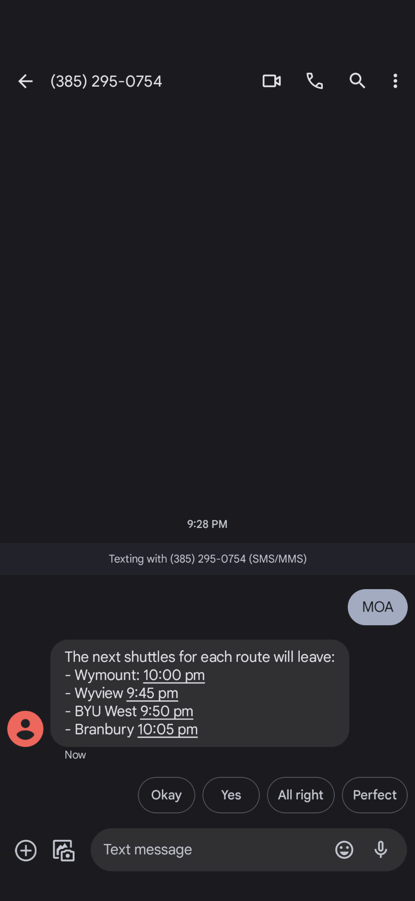
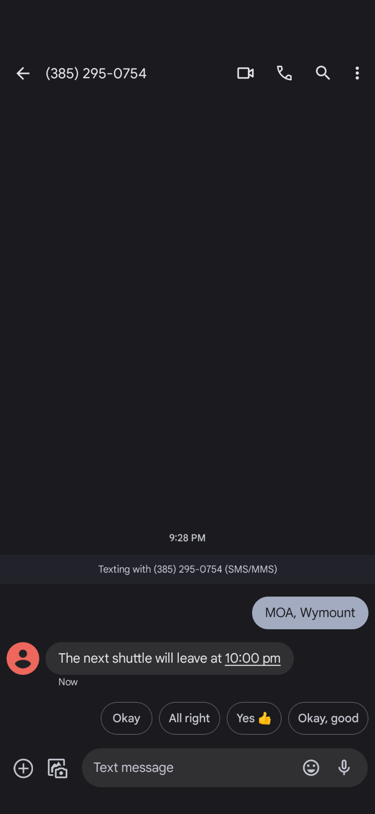

<div align="center">

# 🚌 The Ryde Schedule

**Text your stop, get the next shuttle.** A serverless SMS bot that scraped BYU's shuttle schedules and told
students when the next Ryde was leaving.


-lightgrey)

<p>
  
  &nbsp;&nbsp;
  
</p>

</div>

> [!NOTE]
> This was a personal project from my time at BYU (2022–2023). The live service has been shut down, and the
> code is kept here as a showcase.

## Why

[BYU](https://www.byu.edu) runs a free shuttle service, the **Ryde**, with seven routes connecting campus and
student housing. Checking the next departure meant opening a browser, finding the route's page and scanning a
long list of times.

I had lived in Portugal, where Porto's and Lisbon's transit systems tell you the next departure by text, so I
built the same thing for the Ryde.

## How it works

```
                    ┌──────────────────┐   scrape route pages   ┌───────────────────────┐
  periodic ────────▶│  ryde_scrape λ   │ ──────────────────────▶│ studentmovement.byu.edu│
                    │ (BeautifulSoup)  │                        └───────────────────────┘
                    └────────┬─────────┘
                             │ schedule.json
                             ▼
                        ┌─────────┐
                        │   S3    │
                        └────┬────┘
                             │ read
   SMS "<station>: <route>"  ▼
  ┌──────┐   webhook   ┌──────────────────┐   TwiML reply   ┌──────┐
  │Twilio│ ──────────▶ │  ryde_webhook λ  │ ──────────────▶ │Twilio│ ──▶ 📱
  └──────┘             └──────────────────┘                 └──────┘
```

1. **`ryde_scrape`** runs periodically. It scrapes each route page, normalizes the times into one
   station → route → departures map, and publishes it to S3 as `schedule.json`.
2. **`ryde_webhook`** sits behind a Twilio phone number. It parses the incoming text, works out the next
   departure in Mountain Time, and replies with TwiML.

### Usage

| Text                  | Reply                                                |
| --------------------- | ---------------------------------------------------- |
| `<station>`           | The next departure for every route at that station   |
| `<station>: <route>`  | Just the next departure for that route (e.g. `wyview`) |
| anything unrecognized | The list of valid station names                      |

It also knows when the Ryde doesn't run: weekends and the summer break.

## Tech choices

- **Python + BeautifulSoup** instead of Selenium. The pages are static HTML, so a headless browser (and the
  extra work of fitting browser drivers into Lambda) wasn't needed.
- **Two Lambdas plus S3** keep the SMS path fast and cheap. Scraping happens out of band, and the webhook only
  reads a small JSON file.
- **Twilio** for SMS: easy webhooks and TwiML responses.

## Build

`build.sh` packages each function with its dependencies into a Lambda-ready zip in `out/`:

```bash
./build.sh   # → out/ryde_scrape.zip, out/ryde_webhook.zip
```

```
src/ryde_scrape.py    scraper → S3
src/ryde_webhook.py   Twilio SMS webhook
build.sh              packages both Lambdas
```

---

Built by [Lucas Castro](https://lucasacastro.com) ([@lucasamonrc](https://github.com/lucasamonrc)).
